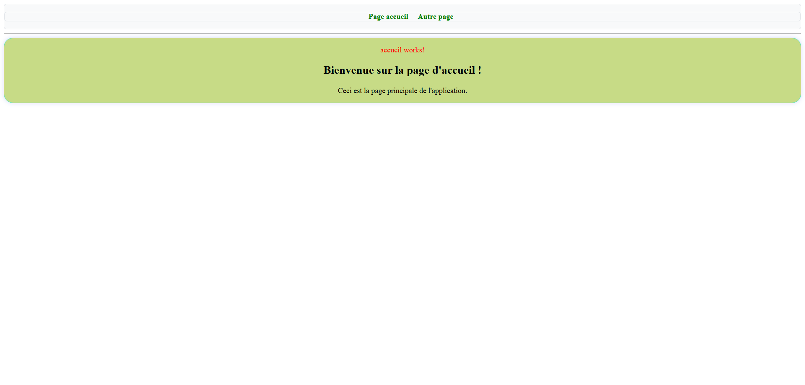
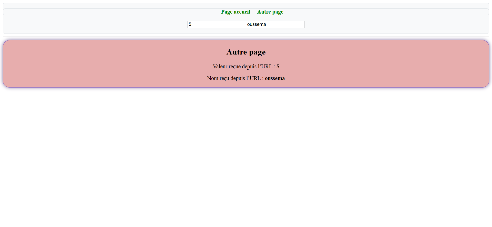
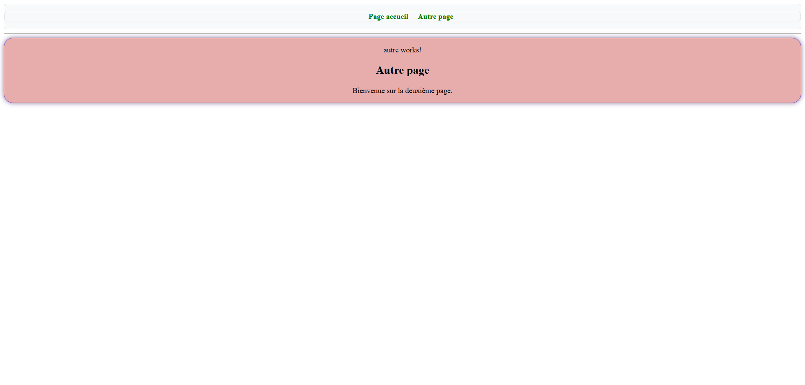

# TP2 - Routage & Paramètres d'URL avec Angular

[](https://angular.dev/)
[](https://www.typescriptlang.org/)
[](https://rxjs.dev/)
[](https://developer.mozilla.org/fr/docs/Web/HTML)
[](https://sass-lang.com/)

Ce projet est un travail pratique (TP) réalisé avec **Angular**. Il permet d'apprendre et de maîtriser :
- Le système de **routage (Angular Router)** pour naviguer entre plusieurs vues sans rechargement de page.
- Le passage et la récupération de **paramètres dynamiques dans l'URL** (`:id/:nom`) avec `ActivatedRoute`.
- La liaison bidirectionnelle (**Two-way data binding**) avec `[(ngModel)]`.
- La gestion des routes inconnues (**Page 404**) via la route wildcard `**`.

---

## 📌 Sommaire

- [Fonctionnalités](#-fonctionnalités)
- [Captures d'écran](#-captures-décran)
- [Fonctionnement du code](#-fonctionnement-du-code)
  - [1. Définition des routes](#1-définition-des-routes)
  - [2. Envoi des paramètres depuis le composant principal](#2-envoi-des-paramètres-depuis-le-composant-principal)
  - [3. Récupération des paramètres avec ActivatedRoute](#3-récupération-des-paramètres-avec-activatedroute)
- [Structure du projet](#-structure-du-projet)
- [Installation et exécution](#-installation-et-exécution)
- [Auteur](#-auteur)

---

## 🚀 Fonctionnalités

1. **Navigation fluide (SPA)** :
   - Liens de navigation avec `routerLink`.
   - Affichage dynamique des composants via `<router-outlet>`.

2. **Route par défaut (Accueil)** :
   - Route `/` associée au composant `AccueilComponent`.

3. **Paramètres dynamiques dans l'URL (`/autre/:id/:nom`)** :
   - Deux champs de saisie (`input`) permettent de saisir un **ID** et un **Nom**.
   - Grâce à `[(ngModel)]`, le lien de navigation s'adapte automatiquement :  
     `/autre/{{valeur}}/{{Valure2}}`.
   - Le composant cible (`AutreComponent`) récupère ces valeurs avec `ActivatedRoute` et les affiche à l'écran.

4. **Gestion de l'erreur 404** :
   - Toute URL invalide est interceptée par la route générique `**` et redirigée vers `NotFoundComponent`.

---

## 📸 Captures d'écran

### 1. Page d'Accueil (`/`)
> Page d'accueil principale avec le menu de navigation et les champs de saisie.



---

### 2. Passage et Réception des Paramètres (`/autre/:id/:nom`)
> Saisie d'un ID et d'un Nom, puis affichage dynamique des valeurs récupérées depuis l'URL dans `AutreComponent`.



---

### 3. Deuxième Page (`/autre`)
> Aperçu de la vue du composant `AutreComponent`.



---

### 4. Page d'erreur 404 (`/**`)
> Affichage du composant `NotFoundComponent` lorsqu'une route saisie n'existe pas.


---

## 🧠 Fonctionnement du code

### 1. Définition des routes
Fichier [`src/app/app.routes.ts`](src/app/app.routes.ts) :

```typescript
import { Routes } from '@angular/router';
import { AccueilComponent } from './accueil/accueil.component';
import { AutreComponent } from './autre/autre.component';
import { NotFoundComponent } from './not-found/not-found.component';

export const routes: Routes = [
  { path: '', component: AccueilComponent },              // Route par défaut (Accueil)
  { path: 'autre/:id/:nom', component: AutreComponent },   // Route avec 2 paramètres dynamiques
  { path: '**', component: NotFoundComponent }            // Route 404 (Wildcard)
];
```

### 2. Envoi des paramètres depuis le composant principal
Fichier [`src/app/app.component.html`](src/app/app.component.html) :

```html
<nav class="nav" align="center">
  <ul class="items nav">
    <li><a routerLink="/">Page accueil</a></li>
    <li><a routerLink="/autre/{{valeur}}/{{Valure2}}">Autre page</a></li>
  </ul>

  <!-- Champs pour saisir l'ID et le Nom -->
  <p>
    <input type="text" [(ngModel)]="valeur" placeholder="Entrez une ID" />
    <input type="text" [(ngModel)]="Valure2" placeholder="Entrez un nom" />
  </p>
</nav>

<hr />
<!-- Emplacement où le composant sélectionné s'affiche -->
<router-outlet></router-outlet>
```

### 3. Récupération des paramètres avec `ActivatedRoute`
Fichier [`src/app/autre/autre.component.ts`](src/app/autre/autre.component.ts) :

```typescript
import { Component, OnInit, OnDestroy } from '@angular/core';
import { ActivatedRoute } from '@angular/router';
import { Subscription } from 'rxjs';

@Component({
  selector: 'app-autre',
  standalone: true,
  templateUrl: './autre.component.html',
  styleUrl: './autre.component.scss'
})
export class AutreComponent implements OnInit, OnDestroy {
  id!: string;
  nom!: string;
  private routeSub!: Subscription;

  constructor(private route: ActivatedRoute) {}

  ngOnInit() {
    // Écoute des paramètres de l'URL
    this.routeSub = this.route.params.subscribe(params => {
      this.id = params['id'];
      this.nom = params['nom'];
    });
  }

  ngOnDestroy() {
    // Désinscription pour libérer la mémoire
    this.routeSub.unsubscribe();
  }
}
```

---

## 📂 Structure du projet

```plaintext
src/
└── app/
    ├── accueil/                 # Composant de la page d'accueil
    │   ├── accueil.component.html
    │   ├── accueil.component.scss
    │   └── accueil.component.ts
    ├── autre/                   # Composant avec paramètres (id & nom)
    │   ├── autre.component.html
    │   ├── autre.component.scss
    │   └── autre.component.ts
    ├── not-found/               # Composant d'erreur 404
    │   ├── not-found.component.html
    │   ├── not-found.component.scss
    │   └── not-found.component.ts
    ├── app.component.html       # Navigation avec ngModel & <router-outlet>
    ├── app.component.ts
    ├── app.component.scss
    └── app.routes.ts            # Configuration des routes
```

---

## 💻 Installation et exécution

### Prérequis

- [Node.js](https://nodejs.org/) (version 18+ recommandée)
- [Angular CLI](https://angular.dev/tools/cli) : `npm install -g @angular/cli`

### Lancer le projet

1. **Cloner le projet :**
   ```bash
   git clone https://github.com/OussEmabouchahwa/-Tp2-Routing-Angular.-.git
   cd -Tp2-Routing-Angular.-
   ```

2. **Installer les dépendances :**
   ```bash
   npm install
   ```

3. **Démarrer le serveur local :**
   ```bash
   ng serve
   ```

4. **Tester dans le navigateur :**
   Ouvrez [http://localhost:4200/](http://localhost:4200/).

---

## 👤 Auteur

- **Oussema Bouchahwa** - [GitHub](https://github.com/OussEmabouchahwa)
